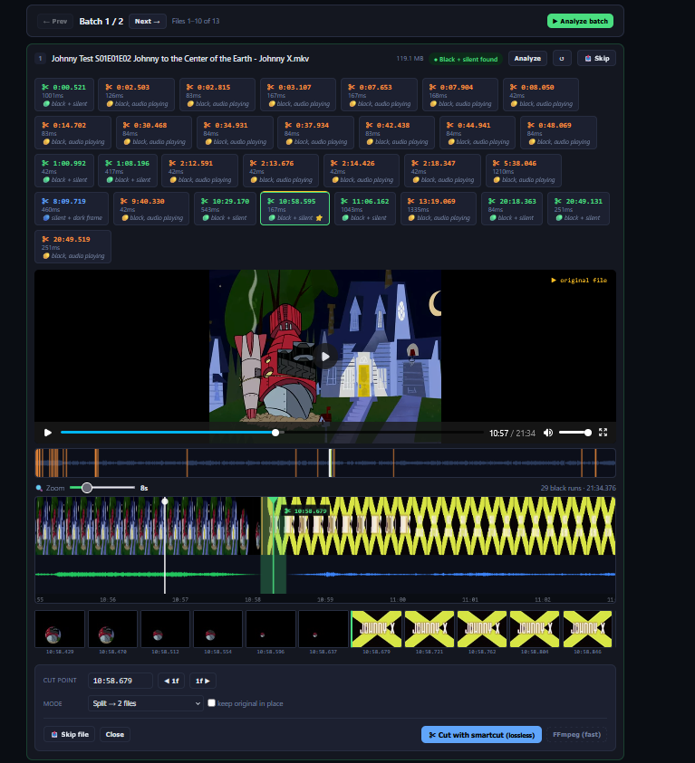

# Media Hacksaw

Media Hacksaw is a small local web tool for finding episode boundaries in MKV
files and splitting them without re-encoding. It uses black frames and silence
to suggest cut points, with a timeline and preview for checking each result.



## Requirements

- Python 3.9 or newer
- FFmpeg and FFprobe available on `PATH`
- SmartCut pip package (required and preferred for accurate lossless cuts)

Install the Python dependency:

```powershell
python -m pip install -r requirements.txt
```

## Launch

From this folder, run:

```powershell
python server.py
```

Open <http://localhost:5000>. The folder field defaults to `./videos` (the
`videos` folder beside `server.py`), so click **Scan** to use it or enter a
different folder. Analyze a file, check the suggested cut, then choose a split
or trim operation. Use **Cut with smartcut** for normal operation. The FFmpeg
button is only a backup and may place cuts away from the selected point. New
files are written to a `cuts` subfolder; processed originals are moved to
`done` unless **keep original in place** is selected.

The **Remux cuts** button stream-copies files in `cuts` folders into `remuxed`
to clean up container timestamps. The server runs locally and listens on port
5000.
